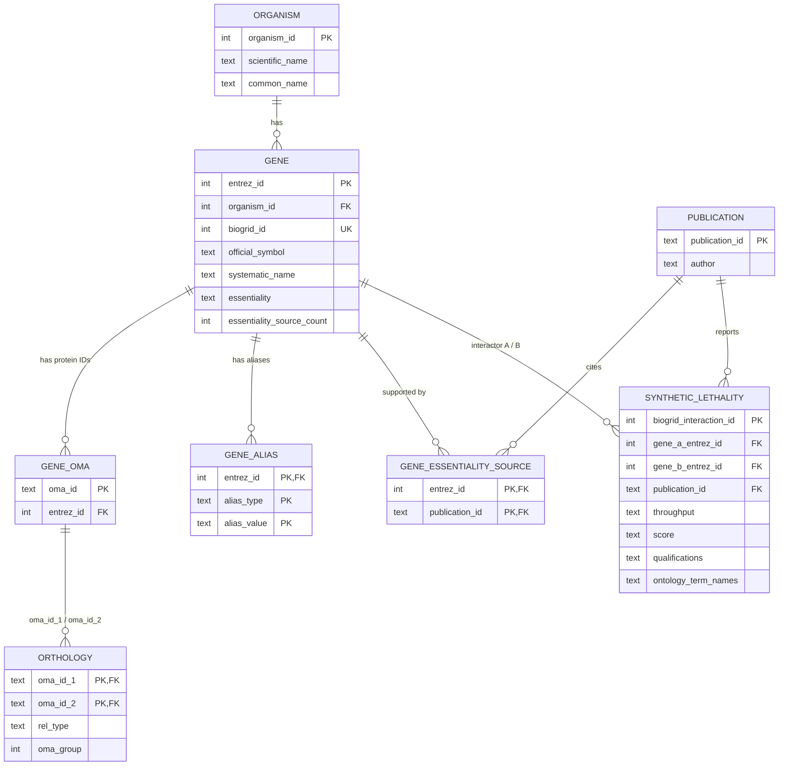
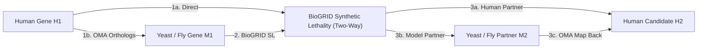

# SynLet Database & Lookup System

## 1. Goal
Given a cancer patient's mutated **human gene**, find **synthetic lethal partner genes** that could kill the cancer cell while sparing healthy cells—combining direct human data with ortholog predictions from model organisms, ranked by safety (**essentiality**) and **evidence confidence**.

---

## 2. Scope & Cleaned Dataset
Only data for our 3 target organisms is kept (`clean_data.py` -> `cleaned/`):

| Organism | Taxon ID | Role | Genes in DB |
| :--- | :---: | :--- | :---: |
| *Homo sapiens* | `9606` | Target organism | 18,881 |
| *Saccharomyces cerevisiae* (Yeast) | `559292` | Model organism | 4,080 |
| *Drosophila melanogaster* (Fruit fly) | `7227` | Model organism | 3,944 |

**Cleaning applied (raw files untouched):**
- **BioGRID:** Filtered to the 3 organisms (`20,056` rows), removed `7` self-interactions, and dropped `5` empty/constant columns (`Modification`, `Tags`, `Experimental System`, `Experimental System Type`, `Source Database`).
- **OMA Pairs:** Removed rows missing an Entrez Gene ID (`239` Yeast, `1,225` Fruit fly) so all rows link cleanly (`2,885` Human–Yeast, `5,258` Human–DROME).
- **G-HumanEssential:** Kept all `18,528` human essentiality records.

---

## 3. Entity-Relationship Diagram (ERD)



### Key Design Decisions & Assumptions
- **Entrez Gene ID as Primary Key (`gene.entrez_id`):** It is the single shared identifier across BioGRID, OMA, and `G-HumanEssential.tsv`, with 0 cross-organism collisions.
- **Separate `gene_oma` table (`1:N`):** One gene can have multiple OMA protein/isoform IDs (up to 19 in Fruit fly). Storing `oma_id` in a child table preserves every identifier cleanly in 3NF.
- **Search by ID + ID Type (`entrez`, `biogrid`, `oma`):** Prevents numeric collisions between Entrez IDs and BioGRID IDs.
- **Two Helper Views:**
  - `v_sl_undirected` makes synthetic lethality symmetric (`A <-> B` and `B <-> A`).
  - `v_gene_orthology` deduplicates isoform-level OMA pairs to unique gene-to-gene pairs before joining BioGRID, preventing inflated scores.

---

## 4. How the 3-Step Lookup Works



1. **Resolve & Expand:** Convert the input (`Entrez`, `BioGRID`, or `OMA` ID) to Human gene `H1`, and collect all Yeast/Fly orthologs `M1` of `H1`.
2. **Two-Way SL Search:** Find all BioGRID synthetic lethal partners of `H1` and `M1` (including cross-species pairs).
3. **Map Back & Filter:** Map any model-organism partner `M2` back to Human `H2` (excluding `H2 = H1`), attach `H2`'s essentiality, and rank.

---

## 5. Ranking & Scoring System

### Primary Order (Safety First)
1. **`Non-essential`** (safest — healthy cells survive without it)
2. **`Unknown`** (not listed in `G-HumanEssential.tsv`)
3. **`Essential`** (risky — knocking it out can harm healthy cells)

### Confidence Score (Within Each Essentiality Group)

| Factor | Rule | Points |
| :--- | :--- | :---: |
| **Directness** | Best path: `Direct Human` (`+50`), `Cross-Species` (`+30`), `Ortholog` (`+15`) | 15 – 50 |
| **Independent Studies** | `+10` per distinct `Publication` (capped at `50`) | 10 – 50 |
| **Multi-Species Confirmation** | Confirmed in more than 1 organism | +20 |
| **Throughput Quality** | `Both` (`+15`), `Low Throughput` (`+10`), `High Throughput` (`+5`) | 5 – 15 |
| **Orthology Confidence** | Best path (`1:1` `+10`, `1:n`/`m:1` `+5`, `m:n` `+2`) + `OmaGroup` (`+3`) | 0 – 13 |

> **Why Low Throughput > High Throughput:** In BioGRID, *Low Throughput* indicates focused, individually validated experiments (higher confidence), whereas *High Throughput* indicates large-scale automated screens. *Both* is strongest. BioGRID's raw `Score` is displayed in details rather than added to the formula because different papers use incompatible scales and ~90% of rows have no score.

---

## 6. How to Run

```bash
# 1. Clean & filter raw files to Human, Yeast, and Fruit fly
python3 clean_data.py

# 2. Build SQLite database (synlet.db)
python3 build_db.py

# 3. Search by Entrez ID, BioGRID ID, or OMA ID (example: FEN1)
python3 search.py --type entrez --id 2237
python3 search.py --type biogrid --id 108528
python3 search.py --type oma --id HUMAN06471

# 4. Inspect full study/interaction evidence for a pair (FEN1 <-> MRE11A)
python3 search.py --type entrez --id 2237 --explain 4361
```
